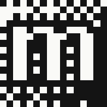

<p align="center">
  
</p>

<h1 align="center">maylog</h1>

<p align="center">
Um weblog pessoal no sentido antigo: um registro. Cada post é uma pasta com um arquivo Markdown; o site lista tudo como um arquivo de log (número, data, tema e título), converte as fotos de banner em pontilhado de 1 bit que muda de cor com o tema, e sai como um site estático em português e inglês, feito com VitePress, Vue e TypeScript, com a estética dos weblogs do começo dos anos 2000.
</p>

<br>

## ✨ Funcionalidades

* Posts em Markdown, um por pasta, com número de registro, tema e tags
* Três temas (white, dark e sepia) e tamanho da página automático pela tela (auto, 100, 110 ou 125%)
* Banners convertidos em pontilhado no build, com clique para ver a foto original
* 20 cenas pontilhadas sorteadas na home, uma nova a cada visita
* Busca em título, tema, tags e texto, com filtros como `tag:java` ou `data:2026.11`
* Arquivo completo com filtros por tema, tag e ano, e ordenação
* Sumário do post com barra fixa, progresso de leitura e rolagem suave
* Destaque de código nas cores do tema, com nome do arquivo e linhas destacadas
* Site inteiro em português e inglês, com versão em inglês opcional por post
* Compartilhar com copiar link, WhatsApp, LinkedIn e imagem para os stories do Instagram
* Prévia do link ao compartilhar (Open Graph), sitemap e feeds em JSON e RSS
* Sem cookies e sem rastreio

<br>

## 📦 Dependências

| Dependência | Para quê |
|---|---|
| [Node.js 18+](https://nodejs.org/) (testado no 24) | Rodar o VitePress e gerar o site |
| [Git](https://git-scm.com/) | Clonar o repositório e publicar os posts |

Bibliotecas (instaladas pelo `npm install`):

* **vitepress / vue**: gera o site estático a partir dos arquivos Markdown, com o tema feito em Vue
* **typescript / vue-tsc**: tipos e checagem do código
* **sharp**: converte banners e cenas em pontilhado durante o build
* **gray-matter**: lê os dados do topo de cada post (`titulo`, `data`, `tema`…)
* **shiki**: destaque de código, ligado às cores de cada tema
* **markdown-it-footnote**: notas de rodapé nos posts
* **lenis**: rolagem suave da página

<br>

## 🚀 Instalação

**Linux**

```bash
# 1. Node.js (se ainda não tiver)
sudo apt install nodejs npm

# 2. Clonar o repositório
git clone https://github.com/maykeesa/maylog-blog.git
cd maylog-blog

# 3. Instalar as dependências
npm install
```

**Windows**

```powershell
# 1. Node.js (se ainda não tiver)
winget install OpenJS.NodeJS.LTS

# 2. Clonar o repositório
git clone https://github.com/maykeesa/maylog-blog.git
cd maylog-blog

# 3. Instalar as dependências
npm install
```

> O repositório é privado: o `git clone` vai pedir para entrar na conta do GitHub com acesso a ele.

<br>

## 💻 Uso

```bash
# Prévia local em http://localhost:5173 (atualiza sozinha ao salvar)
npm run dev

# Gera o site final em .vitepress/dist (com feeds, sitemap e imagens de prévia)
npm run build

# Abre o site gerado em http://localhost:4173, para conferir antes de publicar
npm run preview

# Confere os tipos do código
npm run typecheck
```

Para parar o `npm run dev` ou o `npm run preview`, aperte <kbd>Ctrl</kbd> + <kbd>C</kbd> no terminal.

<br>

## 📝 Adicionando um novo post

### 1. Crie a pasta do post

Dentro de `posts/`, crie uma pasta com o **número do registro** (três dígitos, o próximo da sequência; o primeiro é `001`) e um nome curto, sem acentos e com hífens:

```
posts/
  001-meu-primeiro-texto/
```

O número aparece no site como "nº 001" e define a ordem dos posts. O nome da pasta vira o endereço: `maylog.net/posts/001-meu-primeiro-texto/`.

### 2. Crie o `index.md`

Dentro da pasta, crie o arquivo `index.md`. No topo, entre as linhas `---`, ficam os dados do post; embaixo, o texto:

```md
---
titulo: meu primeiro texto
subtitulo: Uma frase curta que aparece embaixo do título.
data: 2026-11-20
tema: ensaio
tags: [escrita, livros]
banner: banner/banner.jpg
---

O primeiro parágrafo do post. A primeira letra ganha a capitular sozinha.

## uma parte do texto

Mais texto, com **negrito**, *itálico* e [links](https://exemplo.com).
```

| Campo | Obrigatório | O que é |
|---|---|---|
| `titulo` | sim | Título do post, em minúsculas no estilo do site |
| `data` | sim | Data no formato `AAAA-MM-DD` |
| `tema` | sim | Uma palavra: `ensaio`, `técnica`, `notas`, `cinema`… (sem ele, vira `notas`) |
| `subtitulo` | não | Frase embaixo do título; também vira a descrição da prévia do link |
| `tags` | não | Lista entre colchetes: `[java, livros]` |
| `banner` | não | Caminho da foto de capa (passo 3) |
| `contraste` | não | `alto` ou `baixo`, se o banner pontilhado ficar ruim (o padrão é `normal`) |
| `resumo` | não | Resumo escolhido à mão para listas e busca (sem ele, usa o primeiro parágrafo) |

* O tempo de leitura é calculado sozinho.
* Com 3 ou mais subtítulos `##`, o post ganha o sumário no topo.
* Cada tema e cada tag viram links para os arquivos filtrados.
* **Tema novo em inglês:** os temas `ensaio`, `técnica`, `notas` e `cinema` já têm tradução. Para um tema novo aparecer traduzido nas páginas em inglês, adicione-o em `TEMAS_EN`, no fim de `.vitepress/theme/lib/i18n.ts`; sem isso, ele aparece em português.

### 3. Adicione o banner (opcional)

Crie a pasta `banner/` dentro do post, coloque a foto e aponte para ela no topo do `index.md`:

```
posts/001-meu-primeiro-texto/
  index.md
  banner/
    banner.jpg
```

```yaml
banner: banner/banner.jpg
```

O build converte a foto em pontilhado (`banner.dither.png`, gerado sozinho e fora do git). No post, clicar no banner mostra a foto original. O banner pontilhado também vira a imagem da prévia do link (WhatsApp, Discord, X…), com a etiqueta "maylog_ · nº 001".

* **Tamanho ideal:** horizontal, em 16:9, com 1600×900 ou 1920×1080, abaixo de ~500 KB.
* **Formatos aceitos:** `.jpg`, `.png` ou `.webp`.
* **Outros formatos** são cortados para 16:9 na parte com mais detalhe; fotos verticais perdem muito, então vale cortar antes.
* **Se ficar apagado ou escuro demais**, use `contraste: alto` ou `contraste: baixo`.

Sem banner, o post usa uma das cenas pontilhadas da home (sempre a mesma para aquele post), e a prévia do link mostra essa cena emoldurada.

### 4. Adicione imagens no texto (opcional)

Prints e imagens no meio do texto ficam no original, sem pontilhado, com uma borda fina. Coloque numa pasta `imagens/` dentro do post e use o caminho relativo:

```
posts/001-meu-primeiro-texto/
  index.md
  imagens/
    print.png
```

```md


*Legenda em itálico, logo embaixo da imagem.*
```

O texto entre colchetes é a descrição para leitores de tela; escreva o que a imagem mostra. As imagens só carregam quando o leitor chega perto, e o espaço delas já fica reservado (a página não pula). O mesmo caminho funciona na versão em inglês.

### 5. Use os recursos de formatação

#### Texto

```md
**negrito**, *itálico*, ***negrito e itálico***, ~~riscado~~ e `código no meio da frase`

[link para outro post](/posts/001-meu-primeiro-texto/)
[link para fora](https://vitepress.dev)
Um endereço solto vira link sozinho: https://github.com/maykeesa
```

* **Parágrafos:** deixe uma linha em branco entre eles. Uma quebra de linha simples continua no mesmo parágrafo.
* **HTML** funciona quando o Markdown não basta: `<kbd>Ctrl</kbd>` para teclas, `H<sub>2</sub>O` para subscrito, `10<sup>3</sup>` para sobrescrito e `<mark>texto</mark>` para marcar.
* **Emojis** por código: `:tada:` `:coffee:` `:books:`.

#### Subtítulos

```md
## uma parte do texto
### um subtítulo menor
#### um detalhe dentro da parte
```

Só os `##` entram no sumário do topo. Use minúsculas, como no resto do site.

#### Listas

```md
- item com ponto
- outro item
  - subitem (ponto vazado)
    - terceiro nível (quadradinho)

1. passo um
2. passo dois
   1. subpasso
```

Para aninhar, recue o subitem com 2 espaços (3 nas listas numeradas, alinhando com o texto do item de cima).

#### Citações

```md
> Uma citação vira um bloco em itálico com uma linha dupla do lado.

> Uma citação com mais de um parágrafo.
>
> Segundo parágrafo.
>
> — quem disse

> Ele me disse:
>
> > uma citação dentro de outra.
```

#### Código

Blocos de código ganham cores do tema, números de linha e o botão "copiar" sozinhos. Escreva a linguagem depois das três crases; o nome do arquivo entre colchetes aparece na barra do bloco; linhas entre chaves ficam destacadas:

````md
```ts [src/posts.ts]
export function recentes(posts: Post[], n = 6) {
  return posts.slice(0, n)
}
```

```js [destaque.js] {2,4-5}
const tema = 'sepia'
const cor = escolherCor(tema) // linha 2 destacada

function escolherCor(t) {      // linhas 4 e 5 destacadas
  return t === 'dark' ? '#dcdad3' : '#141414'
}
```
````

* **Linguagens:** `ts`, `js`, `vue`, `css`, `html`, `bash`, `json`, `java`, `python`, `sql`, `yaml` e praticamente qualquer outra.
* **Sem linguagem** (só as três crases), o bloco fica como texto puro, bom para saídas de terminal e ASCII art.
* O nome do arquivo e o destaque são opcionais e podem ser usados juntos ou separados.

#### Tabelas

```md
| registro | título            | minutos |
| :------: | :---------------- | ------: |
|   001    | primeiro registro |       1 |
```

Os dois-pontos na linha de baixo do cabeçalho alinham a coluna: `:---` à esquerda, `:---:` ao centro, `---:` à direita.

#### Caixas especiais

```md
::: tip
Uma dica.
:::

::: info
Uma informação neutra.
:::

::: warning
Um aviso.
:::

::: danger
Um perigo.
:::

::: details clique para abrir
Um texto escondido, bom para spoilers.
:::

::: tip um título próprio
Qualquer caixa aceita um título depois do tipo.
:::
```

Sem título, as caixas mostram "dica", "info", "atenção", "perigo" e "detalhes" (em inglês na versão em inglês).

#### Notas de rodapé e separadores

```md
Uma frase com nota de rodapé[^1], e outra com uma nota de nome[^nota-longa].

---

[^1]: Uma nota curta.
[^nota-longa]: Uma nota mais longa, com **formatação** e [links](https://jsonfeed.org).
```

* As notas aparecem no fim do post, numeradas na ordem, com o "↩" para voltar ao ponto do texto. O texto delas pode ficar em qualquer lugar do arquivo; o costume é deixar no fim.
* Uma linha com `---` sozinha (com linha em branco antes e depois) vira um separador horizontal.

### 6. Veja como ficou

```bash
npm run dev
```

Abra http://localhost:5173: o post aparece na home e nos arquivos. Cada vez que você salva o `index.md`, a página atualiza sozinha. Vale olhar nos três temas (white, dark e sepia) e no celular.

### 7. Versão em inglês (opcional)

Crie um `index.en.md` na mesma pasta, só com o título, o subtítulo e o texto traduzidos:

```md
---
titulo: my first text
subtitulo: A short sentence below the title.
---

The first paragraph of the post.
```

* Data, tema, tags e banner vêm do `index.md`. Se usar `resumo` no post, dá para traduzi-lo aqui também.
* Sem o `index.en.md`, a página em inglês mostra o texto em português com um aviso, e o botão "en" do post fica desativado.
* Só os posts com versão em inglês entram no feed em inglês.

### 8. Publique

```bash
git add posts/001-meu-primeiro-texto
git commit -m "feat: adiciona o registro 001 sobre meu primeiro texto"
git push
```

A Vercel publica o site sozinha em cerca de um minuto depois do `git push`.

> **Rascunhos:** comece o nome da pasta com `_` (como `posts/_ideia-nova/`). Ele aparece no `npm run dev` para você ver como está ficando, mas fica fora do site publicado, dos feeds e do sitemap. Para publicar, renomeie a pasta com o número (`004-ideia-nova`).

<br>

## 🖼️ Cenas pontilhadas

As imagens sorteadas na home (e usadas nos posts sem banner) ficam em `cenas/home/`; a TV da página 404 fica em `cenas/404/`. O build converte cada `.jpg` em pontilhado, e o site pinta os pontos na cor do tema.

* **Trocar uma cena:** substitua o `.jpg` mantendo o nome.
* **Criar uma cena:** coloque um `.jpg` novo em `cenas/home/`; ele entra no sorteio sozinho, e o nome do arquivo vira a legenda ("cena: farol").
* **Formato:** a faixa da home é bem larga (340×96); imagens em outro formato aparecem recortadas no meio.
* Imagens em tons de cinza são pontilhadas como estão; fotos coloridas ganham ajuste de contraste, como os banners.

<br>

## ⚙️ Personalização

| Arquivo | O que muda |
|---|---|
| `sobre.md` / `en/sobre.md` | Texto de apresentação da página sobre |
| `conteudo.yml` | Domínio, frase do topo, bloco "agora", canais, redes, contato, ficha, colofão e contador de visitas. Sem mexer em código: salve e, com `npm run dev`, a página atualiza na hora |
| `.vitepress/theme/styles/tokens.css` | Cores dos temas white, dark e sepia |
| `.vitepress/theme/lib/i18n.ts` | Textos da interface em português e inglês |
| `TODO.md` | O que ainda falta fazer |

<br>

## 📁 Estrutura

```
maylog-blog/
├── posts/                 ← um post por pasta (index.md, index.en.md, banner/, imagens/)
├── cenas/                 ← cenas pontilhadas da home (home/), da 404 (404/) e a foto do sobre (sobre/)
├── conteudo.yml           ← textos e links do site (agora, redes, ficha…)
├── en/                    ← páginas em inglês
├── public/                ← favicon e arquivos copiados como estão
├── index.md               ← página inicial
├── arquivos.md            ← página de arquivos
├── sobre.md               ← página sobre
└── .vitepress/
    ├── config.ts          ← configuração do site
    ├── banners.ts         ← conversão de banners e cenas em pontilhado
    ├── feed.ts            ← feeds JSON e RSS
    ├── og.ts              ← imagens e dados da prévia do link
    └── theme/             ← o tema em Vue: páginas, componentes e estilos
```

<br>

## 📄 Direitos autorais

Código e textos © 2026 [Mayke Andrade](https://github.com/maykeesa). Todos os direitos reservados.
