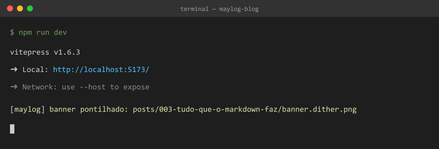

Este post existe para testar o visual. Ele passa por cada coisa que dá para escrever num arquivo `.md` do maylog: textos, listas, citações, código, tabelas, imagens, notas e blocos especiais. Leia trocando entre **white**, **dark** e **sepia** no topo, e apague a pasta quando não precisar mais.

O banner lá em cima é uma foto colorida que o build converteu em pontilhado sozinho. Clique nele para ver a original.

## texto corrido

Um parágrafo comum, com a fonte serifada de leitura e linhas de uns 65 caracteres, que é a largura confortável para ler sem cansar. A primeira letra do post ganha a capitular em fonte mono, como nos jornais antigos.

Dentro do texto dá para usar **negrito**, *itálico*, ***negrito e itálico juntos***, ~~texto riscado~~ e `código no meio da frase`. Links aparecem sublinhados: um [link para outro registro](/posts/001-primeiro-registro/), um [link para fora do site](https://vitepress.dev) e um endereço solto que vira link sozinho, como https://github.com/maykeesa.

Uma quebra de linha simples dentro do parágrafo
continua no mesmo parágrafo. Para começar outro, deixe uma linha em branco.

Também funciona um pouco de HTML quando o Markdown não basta: <kbd>Ctrl</kbd> + <kbd>C</kbd> para teclas, H<sub>2</sub>O para subscrito, 10<sup>3</sup> para sobrescrito e <mark>texto marcado</mark> para destacar.

E emojis por código, se você gostar deles: :tada: :coffee: :books:

### um subtítulo menor

Subtítulos com `###` ficam menores que os de `##` e não entram no sumário do topo, que só lista as partes principais.

#### e um ainda menor

Com `####` dá para separar detalhes dentro de uma parte, sem pesar a página.

## listas

Lista sem numeração, com ponto no primeiro nível, ponto vazado no segundo e quadradinho no terceiro:

- primeiro item
- segundo item, com um texto mais longo para ver como a linha quebra quando passa da largura da coluna e continua alinhada
- terceiro item
  - um subitem
  - outro subitem
    - e um terceiro nível, para quem gosta de hierarquia

Lista numerada, para passos em ordem:

1. abrir a pasta `posts/`
2. criar uma pasta com o número do registro, como `004-meu-post`
3. escrever o `index.md`
   1. os dados do post no topo
   2. o texto embaixo
4. salvar e ver aparecer na home

## citações

> Uma citação vira um bloco em itálico com uma linha dupla do lado.

Citações podem ter mais de um parágrafo e quem disse:

> Escrever é a única forma que conheço de descobrir o que eu penso.
>
> Por isso este blog existe.
>
> — eu mesmo, num dia qualquer

E uma citação dentro de outra:

> Ele me disse:
>
> > não precisa de público para escrever.
>
> E eu acreditei.

## código

Um bloco de código com a linguagem e o nome do arquivo na barra, números de linha e o botão "copiar":

```ts [src/posts.ts]
// como o maylog encontra os posts
interface Post {
  titulo: string
  data: string
  tags: string[]
}

export function recentes(posts: Post[], n = 6): Post[] {
  return [...posts].sort((a, b) => b.data.localeCompare(a.data)).slice(0, n)
}
```

Linhas destacadas, para chamar a atenção para um trecho (aqui, as linhas 2 e 4 a 5):

```js [destaque.js] {2,4-5}
const tema = 'sepia'
const cor = escolherCor(tema) // esta linha está destacada

function escolherCor(t) {
  return t === 'dark' ? '#dcdad3' : '#141414'
}
```

Outras linguagens também ganham cor:

```vue [components/Ola.vue]
<script setup lang="ts">
const nome = 'maylog'
</script>

<template>
  <p class="ola">olá, {{ nome }}</p>
</template>
```

```css
.ola {
  font-family: 'IBM Plex Mono', monospace;
  color: var(--ink);
}
```

```bash
npm install
npm run dev
```

```json [package.json]
{
  "name": "maylog-blog",
  "scripts": { "dev": "vitepress dev" }
}
```

Um bloco sem linguagem fica como texto puro:

```
sem cor, só texto monoespaçado,
bom para saídas de terminal ou ASCII art:

   _ __ ___   __ _ _   _| | ___   __ _
  | '_ ` _ \ / _` | | | | |/ _ \ / _` |
  | | | | | | (_| | |_| | | (_) | (_| |
  |_| |_| |_|\__,_|\__, |_|\___/ \__, |
                   |___/         |___/
```

## tabelas

| tema  | fundo     | tinta     | link      |
| :---- | :-------- | :-------- | :-------- |
| white | `#fafaf7` | `#141414` | azul tinta |
| dark  | `#121212` | `#dcdad3` | azul suave |
| sepia | `#f1e7d0` | `#3b2f22` | vinho     |

Colunas podem ser alinhadas à esquerda, ao centro ou à direita:

| registro | título                  | minutos |
| :------: | :---------------------- | ------: |
|   001    | primeiro registro       |       1 |
|   002    | guia de markdown        |       2 |
|   003    | tudo o que o markdown faz |       6 |

## imagens

Imagens no meio do texto ficam no original, sem pontilhado, com uma borda fina. Bom para prints:



*Print do terminal com o servidor do maylog rodando.*

## blocos especiais

O VitePress tem caixas para chamar a atenção:

::: tip
Uma dica: escreva o título do post antes do texto. Ajuda a não perder o fio.
:::

::: info
Uma informação neutra, sem urgência.
:::

::: warning
Atenção: pastas que começam com `_` são ignoradas. Bom para rascunhos.
:::

::: danger
Perigo: apagar a pasta de um post apaga o post para sempre (a não ser que esteja no git).
:::

::: details clique para ver um detalhe escondido
Este texto só aparece quando alguém abre o bloco. Bom para spoilers de filme.
:::

As caixas também aceitam um título próprio:

::: tip como publicar
Escreva, salve e envie para o GitHub. A hospedagem faz o resto.
:::

## notas e separadores

Uma frase com nota de rodapé[^1], e outra com uma segunda nota[^nota-longa].

Uma linha horizontal separa trechos sem precisar de subtítulo:

---

Depois da linha, o texto continua normalmente. As notas aparecem lá no fim, antes do compartilhar.

[^1]: Uma nota curta.

[^nota-longa]: Uma nota mais longa, com **formatação** e até um [link](https://jsonfeed.org). Ela também tem o "↩" para voltar ao ponto do texto.
